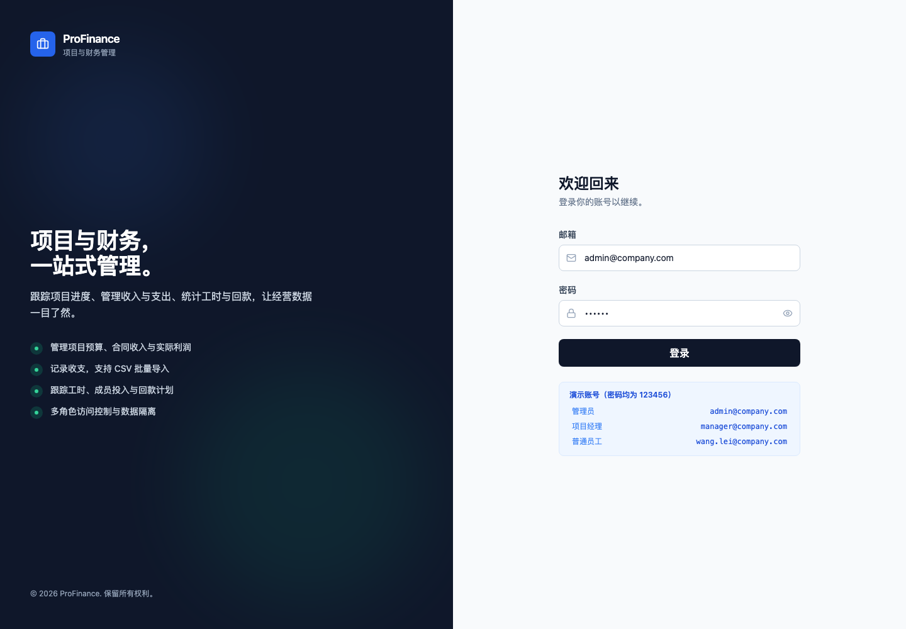
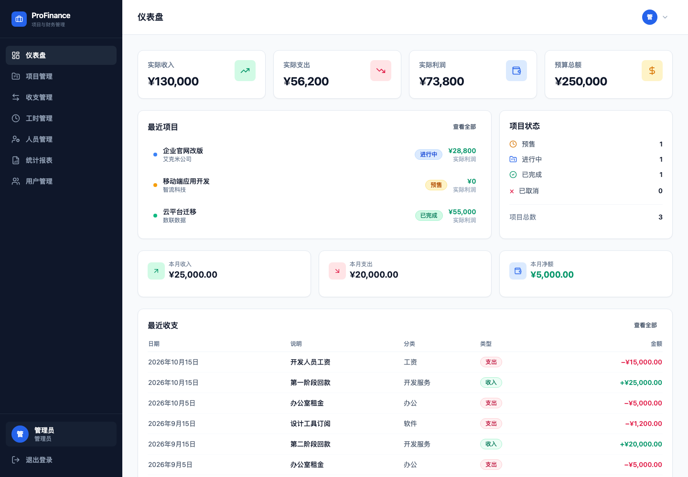
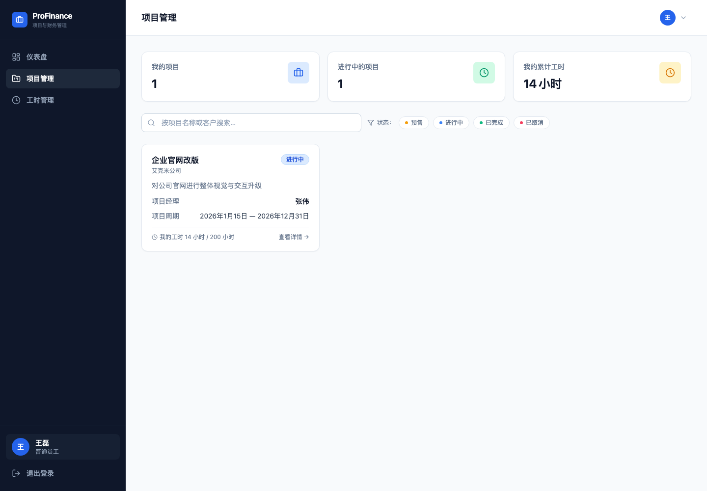

# ProFinance — 项目与财务管理

ProFinance 是一个项目与财务管理应用，覆盖项目预算、收支记账、工时、回款计划、人员与用户权限。前端为 React + TypeScript + Tailwind CSS，后端为 Node.js + SQLite，数据保存在本地，不依赖外部服务。

## 界面预览

| 登录 | 管理员仪表盘 |
|---|---|
|  |  |

普通员工只能看到被分配的项目和本人数据：



## 功能

- **仪表盘**：累计回款 / 累计付款 / 现金净额 / 预算总额，本月回款、项目状态、最近流水
- **项目管理**：项目增删改查、项目分类筛选、状态筛选、预算拆分、合同收入、计划/实际利润、预算使用率；项目负责人从真实用户账号中选择；新建项目内置 Cost Sheet 明细计算，自动推导预算、收入、毛利和审批利润
- **项目详情**：成员分配与计划工时编辑、工时汇总、回款节点增删改与自动对账、预算分类实际执行、Cost Sheet 分析与版本历史、关键文档完整性清单、项目收支
- **收支管理**：收入/支出增删改查、筛选、预算分类、收入关联回款节点、CSV 批量导入
- **工时管理**：工时填报与修改、按项目/人员筛选、CSV 批量导入；填报单位支持小时/天/周/月/年，数据库统一折算为小时存储
- **人员管理**：人员档案、角色、部门、在职状态、人均工时统计；人员是业务主数据，登录账号是人员的可选登录扩展，项目经理/员工账号在人员页开通
- **统计报表**：财务、工时、回款计划三个页签，月/年切换，CSV 导出；财务页包含项目分类汇总（合同额、计划利润、回款、付款、现金净额）
- **用户与权限**：管理员、项目经理、普通员工三种角色；个人资料修改、密码修改、管理员生成一次性密码重置链接；项目经理可查看全部项目汇总统计，但只能查看自己负责项目的明细
- **项目文档**：成本表、合同、SOW、蓝图签字、测试确认、上线确认、项目关闭等分类归档，支持 Excel / Word / PDF，单文件不超过 10 MB；项目详情显示 7 类关键文档的齐备情况
- **审计日志**：管理员可查看项目、收支、工时、回款节点、人员、账号和附件的关键变更，包含操作人、时间、IP 和变更前后快照
- **误操作保护**：项目和收支删除后进入回收站，可填写删除原因并在 30 天内恢复；管理员可永久删除；CSV 导入自动跳过重复记录
- **安全**：密码 scrypt 加盐哈希、HttpOnly 会话 Cookie、服务端 RBAC、一次性重置令牌、上传文件落盘

## 财务口径

系统将“经营利润”和“现金流水”分开表达：

- 合同金额、回款节点使用含税合同额
- 计划利润使用 Cost Sheet 的不含税收入；无 Cost Sheet 的历史项目按项目税率换算不含税收入
- 收支流水代表实际回款/付款，采用收付实现制
- 项目卡片和报表分别展示“回款”“付款”“现金净额”，不再把含税现金流水称为实际利润
- 项目可维护税率，默认 6%，用于历史项目的收入换算

## 技术架构

```
浏览器（React SPA）
  │  HttpOnly Cookie + JSON API
  ▼
Node HTTP API（server/app.mjs）
  │
  ▼
SQLite（data/profinance.db） + 附件目录（data/uploads/）
```

- 前端不再使用 `localStorage` 存业务数据，登录态保存在 HttpOnly Cookie 中。
- 开发模式下 Vite 运行在 `5173`，通过代理访问 `8787` 的 API。
- 生产模式下由 Node 服务同时提供 API 和 `dist/` 静态文件。

## 环境要求

- Node.js **22.5+**（使用内置 `node:sqlite`）
- npm

## 快速开始

```bash
npm install
npm run dev
```

打开 <http://127.0.0.1:5173/>。

首次启动会自动创建数据库并写入中文演示数据。

### Cost Sheet 明细计算

新建/编辑项目弹窗内置 Cost Sheet 明细录入，按成本表模板分组录入合同金额、硬件/服务成本、外包、人力、其他费用、预提税、风险金、附加税等明细，并实时计算：

- 合同总额（TCV）与不含税收入
- 合计成本、项目利润和利润率
- 第三方/人力风险金、其他风险
- 13% 硬件附加税、6% 服务附加税（默认关闭，可通过滑动开关启用）
- 财务利息/保函费用
- 项目审批利润和审批利润率

计算结果会自动同步项目预算和合同收入；新建项目统一使用 Cost Sheet 计算，不再提供手工预算入口。历史无 Cost Sheet 的项目编辑时仍保留手工预算字段。Cost Sheet 原始文件仍可作为“成本表”类型附件归档。

### Cost Sheet 版本

Cost Sheet 明细保存在独立的 `project_cost_sheet_versions` 表中，不再直接把 JSON 作为项目当前值：

- 首次创建项目生成 v1，同时作为基线版本
- 后续只有 Cost Sheet 内容变化时才生成新版本
- 项目仅修改名称、日期等普通字段不会产生新版本
- 当前版本和基线版本分开标记
- 保存新版本时可填写变更说明
- 项目详情可对比当前版本与历史版本，并从历史版本恢复为新版本
- 删除项目时版本记录级联删除
- 历史 `projects.cost_sheet` JSON 会自动迁移为 v1，随后移除旧字段

### 回收站

项目删除后不会立即物理删除，而是进入回收站：

- 项目成员、工时、回款计划和附件随项目隐藏
- 项目经理可恢复自己负责的项目，管理员可恢复全部项目
- 项目经理只能删除自己负责项目的收支；管理员可永久删除
- 回收站显示删除原因、删除人和剩余恢复天数
- CSV 导入按项目、类型、日期、金额、分类和说明检测重复，自动跳过

### 数据加载

登录接口 `/api/bootstrap` 只返回当前用户、权限、人员/用户引用、项目经理和项目选项，不携带项目明细、收支、工时、附件或回款计划。进入页面后再按需加载业务数据：

- 仪表盘使用 `/api/dashboard` 服务端聚合数据和最近记录
- 项目、收支、工时、审计列表使用各自的分页接口
- 项目详情使用 `/api/projects/:id/detail` 只加载当前项目
- 人员使用 `/api/personnel`，报表使用 `/api/reports`
- 报表财务汇总由服务端按所选期间聚合
- 前端不再在登录后统一加载全量业务数据

### 数据库迁移

数据库启动时按 `schema_migrations` 表记录迁移版本。新增结构变更使用带 ID 的迁移函数，已执行迁移不会重复运行；旧数据库会自动补齐 `001`–`009` 迁移记录。

### 分页

项目、收支、工时和审计日志列表使用服务端分页和筛选；项目列表默认每页 12 条，收支和工时默认每页 25 条，审计日志默认每页 50 条。

### 演示账号

| 角色 | 邮箱 | 密码 |
|---|---|---|
| 管理员 | `admin@company.com` | `123456` |
| 项目经理 | `manager@company.com` | `123456` |
| 普通员工 | `wang.lei@company.com` | `123456` |

> 演示账号提示仅在开发模式显示；生产构建不会展示账号或默认密码。首次部署后请立即通过右上角菜单“修改密码”。忘记密码时，可由管理员在账号管理中生成 30 分钟有效的一次性重置链接。

### 生产运行（本机 Node）

```bash
npm run build
npm start
```

默认地址：<http://127.0.0.1:8787/>。可通过环境变量调整：

| 变量 | 默认值 | 说明 |
|---|---|---|
| `PF_HOST` | `127.0.0.1` | 监听地址；Docker/内网访问时设为 `0.0.0.0` |
| `PF_PORT` / `PORT` | `8787` | 生产服务端口 |
| `PF_DB_PATH` | `data/profinance.db` | SQLite 数据库路径 |
| `PF_UPLOAD_DIR` | `data/uploads` | 附件目录 |
| `PF_SECURE_COOKIE` | 未设置 | 设为 `1` 时 Cookie 增加 `Secure`（HTTPS 部署时启用） |

## 测试

```bash
npm test          # 后端 API / 数据库测试
npm run test:e2e  # Playwright 端到端测试
npm run check     # typecheck + lint + 后端测试 + 生产构建
```

Playwright 测试覆盖登录、工时整数校验、Cost Sheet 版本历史/恢复和审计日志页面。CI 配置位于 `.gitea/workflows/ci.yml`，当前未接入 Runner，接入后会自动执行检查并运行 Chromium E2E。

## Docker 部署

项目已包含 `Dockerfile`、`docker-compose.yml`、Caddy 反向代理配置和持久卷。  
**不需要在宿主机安装 SQLite**，Node 镜像已内置 `node:sqlite`。

### 方式一：本机/内网快速运行

```bash
docker compose up -d --build
curl http://127.0.0.1:8787/api/health
```

- 访问：<http://127.0.0.1:8787/>
- 应用端口仅绑定到宿主机 `127.0.0.1`，不直接暴露公网。
- 数据保存在命名卷 `profinance-data` 中（数据库 + 附件）。
- 默认 `PF_SECURE_COOKIE=0`，适合本地 HTTP 测试；公网 HTTPS 部署请设为 `1`。

### 方式二：生产环境 + Caddy 自动 HTTPS

1. 将域名 DNS 解析到服务器公网 IP，放行 `80/443` 端口。
2. 准备配置：

```bash
cp deploy/production.env.example deploy/production.env
vi deploy/production.env
```

至少修改：

```dotenv
APP_DOMAIN=profinance.example.com
PF_SECURE_COOKIE=1
```

3. 启动应用与 Caddy：

```bash
docker compose --env-file deploy/production.env --profile proxy up -d --build
docker compose ps
docker compose logs -f app
```

Caddy 会自动申请并续期 HTTPS 证书；应用仅通过容器网络暴露给 Caddy。  
反向代理配置见 [deploy/Caddyfile](deploy/Caddyfile)。

> 如果已经有 Nginx / 云负载均衡，只需运行 `docker compose up -d app`，将上游指向 `127.0.0.1:8787`，并把 `PF_SECURE_COOKIE` 设为 `1`。

### 数据卷与备份

```bash
# 查看卷
docker volume inspect profinance-data

# 停止应用后做一致性备份
docker compose stop app
mkdir -p backups
docker run --rm \
  -v profinance-data:/data \
  -v "$PWD/backups":/backup \
  alpine sh -c 'tar czf /backup/profinance-$(date +%F-%H%M).tgz -C /data .'
docker compose start app
```

恢复时把备份包解压回 `profinance-data` 卷即可。`docker compose down` 会保留数据卷；`docker compose down -v` 会**删除数据库和附件**，请谨慎使用。

### 镜像与容器说明

- 构建阶段安装依赖并执行 `npm run build`，运行阶段只包含 `dist/`、`server/` 和 Node 运行时。
- 容器以非 root 用户 `node` 运行。
- 应用在容器内监听 `0.0.0.0:8787`，宿主机端口默认只映射到 `127.0.0.1`。
- 健康检查：`/api/health`。
- 首次启动自动建库并写入中文演示数据。

## 权限模型

| 能力 | 管理员 | 项目经理 | 普通员工 |
|---|---|---|---|
| 仪表盘 | 全部数据 | 全部项目汇总；明细仅自己负责项目 | 仅自己项目与工时 |
| 项目管理 | 全部 | 全部项目汇总；仅自己负责项目可看明细/编辑 | 仅被分配项目（只读） |
| 收支管理 | 全部 | 仅自己负责项目 | 无权访问 |
| 工时管理 | 全部人员 | 仅自己负责项目 | 仅本人 |
| 人员管理 | 全部 | 全部 | 无权访问 |
| 统计报表 | 全部 | 仅自己负责项目明细 | 无权访问 |
| 账号管理 | 全部 | 无权访问 | 无权访问 |
| 项目财务/回款/附件 | 可见可管理 | 仅自己负责项目可见可管理 | 不可见 |

权限同时在服务端和界面层校验；即使绕过界面直接请求 API，也会被拒绝。

### 项目分类

新建项目必须选择项目分类，项目管理页可按分类单选筛选：

| 分类编码 | 显示名称 |
|---|---|
| `erp_delivery` | ERP交付类 |
| `custom_development` | 定制开发类 |
| `integration_implementation` | 集成实施类 |
| `operations_service` | 运维服务类 |
| `consulting_service` | 咨询服务类 |
| `other` | 其他 |

历史项目保留为“未分类”，不自动归类；可在编辑项目时补充分类。

### 人员与账号模型

- **人员**是业务主数据：姓名、部门、业务角色、联系方式，用于项目成员、工时和统计。
- **账号**是人员的可选登录扩展：登录邮箱、密码、系统角色、启用状态。
- 项目经理和普通员工必须有且只有一个关联账号；管理员可以是无人员档案的系统账号。
- 管理员在人员管理页为人员开通账号；账号管理中只维护登录邮箱、系统角色、状态和密码，不再手工选择人员。
- 人员姓名是姓名唯一来源；登录邮箱是账号登录凭据，人员邮箱作为联系邮箱。

## 数据与备份

- 数据库：`data/profinance.db`
- 附件：`data/uploads/`
- 备份：停止服务后复制 `data/` 目录即可。
- 重置演示数据：

```bash
# 先停止 npm run dev / npm start
npm run db:reset
npm run dev
```

`data/` 已加入 `.gitignore`，不会提交到版本库。

## 常用命令

| 命令 | 说明 |
|---|---|
| `npm run dev` | 同时启动 API（8787）和 Vite（5173） |
| `npm run dev:web` | 只启动 Vite |
| `npm run dev:api` | 只启动 API（监听文件变更） |
| `npm run build` | 生产构建到 `dist/` |
| `npm start` | 启动生产服务（需先构建） |
| `npm run typecheck` | TypeScript 类型检查 |
| `npm run lint` | ESLint |
| `npm test` | 后端集成测试（认证、权限、附件、管理员保护） |
| `npm run check` | typecheck + lint + test + build |

## 目录结构

```
Dockerfile                 多阶段生产镜像
docker-compose.yml         应用 + 可选 Caddy 反向代理
deploy/
  Caddyfile                Caddy 反向代理配置
  production.env.example   生产环境变量示例
server/
  app.mjs                  API 路由、认证、权限、业务校验
  db.mjs                   SQLite 表结构、密码哈希、中文种子数据
  index.mjs                生产静态服务 + API 服务
  app.test.mjs             后端集成测试
scripts/
  dev.mjs                  同时启动 API 与 Vite
  reset-db.mjs             清空本地数据
src/
  components/              布局、通用 UI、Toast
  context/                 认证上下文
  lib/                     API、数据缓存、路由、财务计算、CSV、格式化
  pages/                   各业务页面
  types/                   类型与中文枚举
```

## 安全说明

- 密码使用 `scrypt` 加盐哈希存储，数据库中不保存明文密码。
- 会话使用 HttpOnly + SameSite=Lax Cookie，前端无法读取。
- 所有写操作在服务端做角色校验；员工访问非分配项目、他人工时、财务数据都会被拒绝。
- 附件支持 `.xlsx/.xls/.doc/.docx/.pdf`，单文件 10 MB，文件保存在磁盘上。
- 本地 HTTP 环境未启用 `Secure` Cookie；上线请使用 HTTPS 并设置 `PF_SECURE_COOKIE=1`。
- Docker 镜像以非 root 用户运行，应用端口仅绑定宿主机回环地址，由 Caddy/Nginx 对外提供 HTTPS；建议再加限流、防火墙和定期备份。
- SQLite 适合单实例部署；如需多副本横向扩容，应迁移到 PostgreSQL 等网络数据库。

